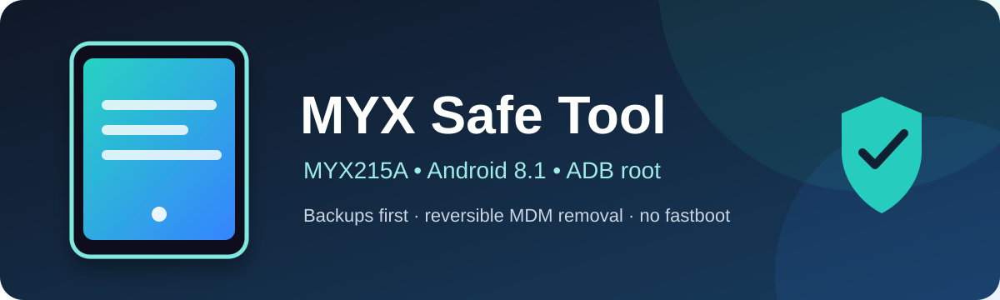
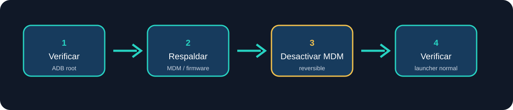
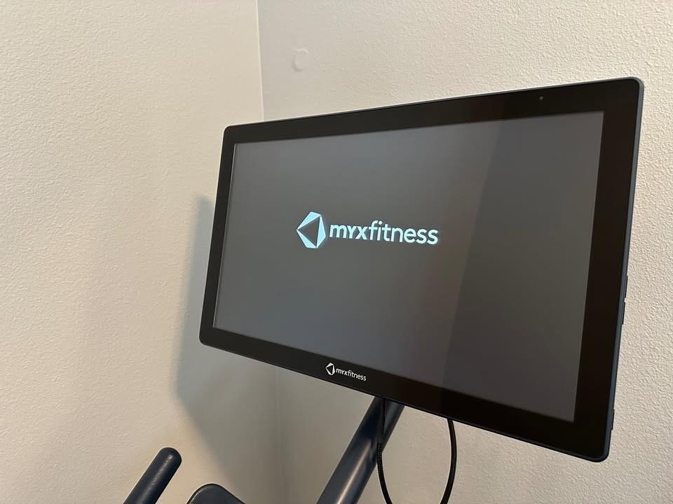

# MYX215A como tablet Android normal

<p align="center">
  
</p>

<p align="center">
  Respaldo seguro y eliminación reversible del login/MDM de MYX Fitness.
</p>

<p align="center">
  
</p>

## Referencias visuales

<p align="center">
  
</p>

<p align="center">
  
</p>

Guía manual para convertir una MYX Fitness MYX215A en una tablet Android normal, quitando el login/kiosco de MYX sin desbloquear el bootloader.

## Método automático

Este repositorio también incluye un menú automático para realizar el respaldo y quitar el login/MDM de forma reversible:

```bash
cd /run/media/rodrigo555a/MYX_DATA/MYX/myx_automation
./myx_menu.sh
```

El menú tiene cinco opciones: verificar el dispositivo, crear respaldo pequeño, crear respaldo completo, quitar el MDM y volver a detectar otra MYX. Para usar únicamente el método automático, consulta [`GUIA_USO_MYX_MENU.md`](GUIA_USO_MYX_MENU.md).

El resto de este README documenta el procedimiento manual paso a paso.

## Alcance y seguridad

Este método usa ADB root y modifica únicamente el APK MDM y sus políticas. El bootloader permanece bloqueado.

No ejecutar:

```text
fastboot flash
fastboot erase
fastboot flashing unlock
Format All
wipe data
wipe system
wipe cache
```

No modificar `NVRAM`, `NVDATA`, `userdata`, `preloader`, `proinfo` ni `seccfg`.

## Condiciones previas

- MYX encendida y dentro de Android.
- Pantalla desbloqueada y encendida.
- Depuración USB activa.
- Cable USB de datos.
- Wi-Fi desconectado durante la modificación.
- Una sola MYX conectada.
- Ubuntu/Linux con `adb` instalado.

Mantener la pantalla despierta opcionalmente:

```bash
adb shell svc power stayon true
```

## 1. Identificar la pantalla

```bash
adb devices -l
adb shell getprop ro.build.display.id
adb shell getprop ro.build.version.release
adb shell getprop ro.product.cpu.abilist
```

Debe ser una `MYX215A` con Android 8.1 y arquitectura ARM64.

## 2. Obtener ADB root

```bash
adb root
adb wait-for-device
adb shell id
```

Debe aparecer `uid=0(root)`. Si no aparece, detenerse.

## 3. Respaldar MDM y políticas

```bash
mkdir -p ~/backup_myx215a_manual/{apks,policy}

adb pull /system/priv-app/MDMMYX/MDMMYX.apk \
~/backup_myx215a_manual/apks/MDMMYX.apk

adb pull /data/system/device_owner_2.xml \
~/backup_myx215a_manual/policy/device_owner_2.xml

adb pull /data/system/device_policies.xml \
~/backup_myx215a_manual/policy/device_policies.xml

adb pull /data/system/users/0.xml \
~/backup_myx215a_manual/policy/user_0.xml
```

## 4. Desactivar verity y montar system

```bash
adb disable-verity
adb reboot
adb wait-for-device
adb root
adb wait-for-device
adb remount
```

Debe mostrar `remount succeeded`.

## 5. Desactivar el MDM sin borrarlo

```bash
adb shell 'set -e
cp -p /system/priv-app/MDMMYX/MDMMYX.apk /data/local/tmp/MDMMYX.apk.original
mv /system/priv-app/MDMMYX/MDMMYX.apk /system/priv-app/MDMMYX/MDMMYX.apk.disabled
sync'
```

Verificar:

```bash
adb shell ls -l /system/priv-app/MDMMYX/
adb shell pm path com.abupdate.mdm
```

Reiniciar:

```bash
adb reboot
adb wait-for-device
adb root
adb wait-for-device
```

## 6. Limpiar Device Owner y políticas MDM

Crear `device_owner_2.xml`:

```xml
<?xml version='1.0' encoding='utf-8' standalone='yes' ?>
<root />
```

Crear `device_policies.xml`:

```xml
<?xml version='1.0' encoding='utf-8' standalone='yes' ?>
<policies setup-complete="true" provisioning-state="0" />
```

Enviar y aplicar:

```bash
adb push device_owner_2.xml /data/local/tmp/device_owner_2.new.xml
adb push device_policies.xml /data/local/tmp/device_policies.new.xml

adb shell 'set -e
cp /data/local/tmp/device_owner_2.new.xml /data/system/device_owner_2.xml
cp /data/local/tmp/device_policies.new.xml /data/system/device_policies.xml
chown system:system /data/system/device_owner_2.xml
chown system:system /data/system/device_policies.xml
chmod 600 /data/system/device_owner_2.xml
chmod 600 /data/system/device_policies.xml
sync'
```

Reiniciar:

```bash
adb reboot
adb wait-for-device
adb root
adb wait-for-device
```

Verificar:

```bash
adb shell dumpsys device_policy \
| grep -E 'Device Owner|admin=|package=|lock-task|statusbar'
```

No debe aparecer `com.abupdate.mdm`, `lock-task` ni `statusbar disabled`.

## 7. Barra de navegación

La barra superior de notificaciones y la barra inferior de navegación son independientes.

Para la barra inferior instalar la aplicación Navigation Bar:

```bash
nav_apk=$(find ~/Descargas -maxdepth 1 -type f \
-iname 'Navigation*Bar*Android*3.3.0*.apk' \
-print -quit)

adb install -r "$nav_apk"
```

Conceder en la MYX:

- Accesibilidad.
- Mostrar sobre otras aplicaciones.
- Permitir instalar desde esa fuente.

## 8. Aurora Store y aplicaciones

Play Store no funcionó porque faltan Google Play Services y Google Services Framework.

Instalar Aurora Store:

```bash
adb install -r ~/Descargas/AuroraStore-4.8.4.apk
```

Permitir instalaciones:

```bash
adb shell am start \
-a android.settings.MANAGE_UNKNOWN_APP_SOURCES \
-d package:com.aurora.store
```

Si aparece `not allowed`:

```bash
adb shell appops set com.aurora.store REQUEST_INSTALL_PACKAGES allow
```

Desde Aurora se pueden instalar Chrome, TikTok y otras aplicaciones compatibles.

El YouTube oficial requiere Google Play Services. Para ver videos se recomienda NewPipe.

## 9. Restaurar si fuera necesario

```bash
adb root
adb remount
adb shell 'mv \
/system/priv-app/MDMMYX/MDMMYX.apk.disabled \
/system/priv-app/MDMMYX/MDMMYX.apk; sync'
```

Las políticas originales deben restaurarse desde el respaldo del mismo dispositivo.

## 10. Finalizar

Después de comprobar launcher, barra superior y barra inferior:

1. Volver a conectar Wi-Fi.
2. Abrir Aurora Store.
3. Instalar aplicaciones.
4. Guardar el respaldo en otra unidad.
5. Mantener una carpeta independiente por número de serie.
